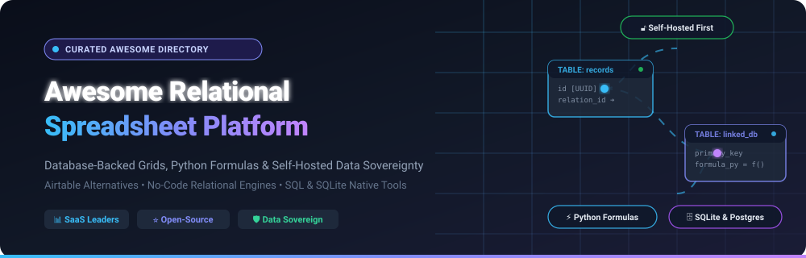

# 📊 Awesome Relational Spreadsheet Platform

  

  
  
  
  
  
  

---

## 🧭 Overview & Architecture

Welcome to the definitive directory of **Relational Spreadsheet Platforms** — encompassing both market-leading **SaaS ecosystems** and high-performance **open-source GitHub projects**. 

Relational spreadsheet platforms bridge the ergonomic divide between the intuitive grid manipulation of spreadsheets and the structural integrity of relational database management systems (RDBMS). By combining typed columns, foreign-key relations, granular cell- and row-level access control, API endpoints, and reactive formula runtimes, these platforms liberate teams from fragile `.xlsx` workflows without requiring full-stack custom software development.

### 🎯 Key Focus Areas
- 🗄️ **Database-Backed Grids**: Frontends that map directly to SQLite, PostgreSQL, MySQL, or SQL Server.
- ⚡ **Formula Runtimes**: Standard spreadsheet formulas alongside full Python, JavaScript, and SQL execution.
- 🔓 **Data Sovereignty & Self-Hosting**: Open-source solutions deployable on-premise, air-gapped, or in private clouds.
- 🤖 **AI Agents & Low-Code Integrations**: Natural-language schema builders, automations, and instant REST/GraphQL APIs.

---

## 📑 Table of Contents
- [📈 Sector Overview & Market Dynamics](#-sector-overview--market-dynamics)
- [☁️ SaaS & Hosted Platforms](#️-saas--hosted-platforms)
- [🛠️ Open-Source GitHub Projects](#️-open-source-github-projects)
  - [📊 Open-Source Quick Comparison Matrix](#-open-source-quick-comparison-matrix)
  - [🔍 Deep Dives by Stars_Count](#-deep-dives-by-star-count)
- [💡 Architectural Evaluation Guide](#-architectural-evaluation-guide)
- [🤝 How to Contribute](#-how-to-contribute)
- [⭐ Star History](#-star-history)
- [💖 Support & Community](#-support--community)
- [⚖️ Disclaimer](#️-disclaimer)

---

## 📈 Sector Overview & Market Dynamics

The global collaborative work management, spreadsheet, and no-code database market was valued at **~$13.4 billion in 2024** and is projected to surpass **$38.5 billion by 2030**, advancing at a robust compound annual growth rate (**CAGR of ~18.5%**).

The sector exhibits **moderate fragmentation with an oligopolistic tier at the top**:
- **Market Concentration**: Heavyweights such as Airtable, Monday.com, Smartsheet, and Notion capture an outsized share of enterprise enterprise seats and brand awareness.
- **Why It Is Not "Winner-Take-All"**: The domain cannot converge on a single monolithic winner due to fundamentally conflicting architectural trade-offs. Teams requiring mission-critical SQL fidelity (e.g., PostgreSQL backends) cannot rely on document-centric stores; meanwhile, regulated enterprises, healthcare providers, and privacy-conscious organizations reject proprietary cloud lock-in and steep per-seat taxes. This dynamic sustains a rapidly expanding open-source ecosystem (NocoDB, Teable, Grist, Baserow, Directus) catering to self-hosted data sovereignty, zero row limits, and transparent database connectivity.

---

## ☁️ SaaS & Hosted Platforms

Below is an exhaustive breakdown of the leading hosted relational spreadsheet platforms, sorted in **descending order by company valuation / market capitalization**.

| Platform | Company Size (Valuation / Revenue) | Starting Tier Pricing | Free Tier Limits | Key Relational Focus & Best For |
| :--- | :--- | :--- | :--- | :--- |
| **[Google Tables / AppSheet](https://tables.google.com/)** | **~$2.1T+ Market Cap** (Alphabet Inc. parent backing; ~$307B annual revenue) | **$5 / user / month** (AppSheet Starter plan; also included in select Workspace tiers) | **Free (Prototype Plan)**: Up to 10 test users, 5 databases per account, 1,000 rows per database, max 20 tables/db, 100 columns/table. Automations cannot run on live triggers in free mode. | Native structured relational tables integrated with Google Workspace, Gmail, and AppSheet workflow triggers. Best for Google Workspace enterprises. |
| **[Monday.com](https://monday.com/)** | **~$12.5B Market Cap** (NASDAQ: MNDY; ~$950M+ ARR) | **$9 / seat / month** billed annually ($12 monthly; **enforces 3-seat minimum = $27/mo min**) | **Free Forever (Individual)**: Up to 2 seats, max 3 boards, 3 docs, 500 MB storage, and 200+ templates. No automations, integrations, or Gantt/Timeline views. | Work OS blending relational column linkages, task dependencies, and Kanban/dashboard views. Best for cross-functional project tracking. |
| **[Airtable](https://www.airtable.com/)** | **$11.7B Valuation** (Series F; ~$300M+ ARR) | **$20 / seat / month** billed annually ($24 monthly for Team Plan) | **Free Forever**: Up to 5 editors, 1,000 records per base, 1 GB attachment storage per base, 100 automation runs/month, 1,000 API calls/month. Limited to 1 extension. | The category-defining relational spreadsheet. Rich field types, linked tables, interface designer, and synced bases. Free tier strictly caps base scale. |
| **[Notion](https://www.notion.com/)** | **$10.0B Valuation** (Private funding round; ~$250M+ ARR) | **$10 / seat / month** billed annually ($12 monthly for Plus Plan) | **Free Forever**: Unlimited blocks/pages for solo users (capped at 1,000 shared blocks for 2+ members), 5 MB file upload limit, 7-day version history, and up to 10 external guests. | Connected workspace fusing flexible documents with relational databases (rollups, relation fields, formulas). Best for knowledge bases and lightweight ops. |
| **[Smartsheet](https://www.smartsheet.com/)** | **$8.4B Enterprise Value** (Acquired by Blackstone & Vista Equity; ~$1.1B ARR) | **$9 / user / month** billed annually ($12 monthly for Pro Plan; up to 10 members) | **30-Day Free Trial** (Full Business tier feature access; legacy free plan was 1 user, 2 sheets, 500 MB storage, 100 automations/mo). After 30 days, shifts to read-only unless upgraded. | Enterprise spreadsheet with Gantt schedules, resource management, sheet cell-linking, and corporate compliance controls. |
| **[ClickUp](https://clickup.com/)** | **$4.0B Valuation** (Series C; ~$150M+ ARR) | **$7 / member / month** billed annually ($10 monthly for Unlimited Plan) | **Free Forever**: 100 MB total workspace storage, unlimited tasks, unlimited members, 5 Spaces, 60 uses of Custom Fields, 100 automation runs/month. | All-in-one productivity suite with Table View providing relational-style column grids, task relations, and custom automations. |
| **[Coda](https://coda.io/)** | **$1.4B Valuation** (Series D; ~$40M+ ARR) | **$10 / Doc Maker / month** billed annually ($12 monthly for Pro Plan; **Editors and Viewers are free**) | **Free Forever**: Unlimited Doc Makers, unnested docs up to 50 objects (tables/views/pages) and 1,000 rows per doc, 10 MB doc size, and basic automation quotas. | Blends documents with relational tables, interactive buttons, full formulas, and external third-party integrations ("Packs"). |
| **[Quickbase](https://www.quickbase.com/)** | **~$1.0B+ Valuation** (Acquired by Vista Equity; ~$250M+ revenue) | **$35 / user / month** billed annually (Team Plan; enforces contract floor / minimum seats) | **30-Day Free Trial**: Complete access to Business Plan features, custom relational app designer, sandbox, and automated workflows. No perpetual free tier. | Enterprise no-code application platform designed for complex operational databases, field service tracking, and regulatory governance. |
| **[SmartSuite](https://www.smartsuite.com/)** | **~$150M Est. Valuation** (~$15M+ founder investment) | **$15 / user / month** billed annually ($20 monthly for Team Plan; **3-user minimum = $45/mo**) | **14-Day Free Trial** of Professional Plan: Up to 100,000 records per solution and 100 GB storage (no credit card required; permanent free plan was sunset in 2026). | Collaborative work management platform featuring relational Solutions, 40+ field types, granular permissions, and cross-solution linked records. |
| **[Rows](https://rows.com/)** | **~$70M Est. Valuation** (~$22M venture funding) | **$6 / user / month** billed annually ($8 monthly for Plus Plan) | **Free Forever**: Up to 3 guests, unlimited spreadsheets, up to 100,000 rows and 1,000,000 cells per table, 1 MB file import, 5 AI tasks/mo, 500 API calls/month. | Modern spreadsheet supercharged with built-in API connectors, web scrapers, and an integrated AI Data Analyst for formula automation. |

---

## 🛠️ Open-Source GitHub Projects

The open-source relational spreadsheet ecosystem has exploded to offer enterprise-grade capabilities: zero artificial record caps, complete database ownership, Python formulas, and air-gapped self-hosting.

Below, all projects are **sorted in descending order by GitHub Stars_Count**. Each Stars_Badge links directly to that repository's stargazers page.

### 📊 Open-Source Quick Comparison Matrix

| Repository | GitHub_Stars | Primary License | Core Storage Engine | Formula Engine | API Capabilities |
| :--- | :--- | :--- | :--- | :--- | :--- |
| **[NocoDB](https://github.com/nocodb/nocodb)** |  | AGPL-3.0 | Existing PostgreSQL / MySQL / SQL Server / SQLite | Excel-style + Custom Formula Builder | Auto-generated REST + Webhooks |
| **[Directus](https://github.com/directus/directus)** |  | BSL 1.1 / Apache 2.0 | Any SQL Database (Postgres, MySQL, SQLite, Oracle, MariaDB) | Dynamic Computations & Flows | Real-time REST + GraphQL + WebSockets |
| **[Budibase](https://github.com/Budibase/budibase)** |  | GPL-3.0 | Budibase Internal DB (CouchDB) / External SQL | JavaScript & Built-in Bindings | REST API + Webhooks |
| **[Teable](https://github.com/teableio/teable)** |  | AGPL-3.0 | Pure Native PostgreSQL | SQL Expressions & Real-time formulas | Full OpenAPI REST + Real-time Sync |
| **[APITable](https://github.com/apitable/apitable)** |  | AGPL-3.0 | MySQL & Redis | Spreadsheet Formulas & Rollups | REST API + Automation Widgets |
| **[Grist](https://github.com/gristlabs/grist-core)** |  | Apache-2.0 | SQLite (Portable Single-File `.grist`) | **Full Python Standard Library** | REST API + Custom Webhook Widgets |
| **[Rowy](https://github.com/buildship-ai/rowy)** |  | Apache-2.0 | Google Cloud Firestore / Firebase | JavaScript / TypeScript Cloud Functions | Cloud Run Webhooks & REST |
| **[Baserow](https://github.com/baserow/baserow)** |  | MIT (Open Core) | PostgreSQL (Django ORM Backend) | Rich Functional Formula Language | OpenAPI REST + Webhooks |
| **[Mathesar](https://github.com/mathesar-foundation/mathesar)** |  | GPL-3.0 | Native PostgreSQL (Direct Schema Reflection) | Native PostgreSQL Functions & SQL | REST API over Postgres Schema |
| **[Undb](https://github.com/undb-io/undb)** *(Archived)* |  | MIT | Single-File SQLite | Lightweight Formulas | OpenAPI + Real-time Subscriptions |
| **[Saltcorn](https://github.com/saltcorn/saltcorn)** |  | MIT | PostgreSQL / SQLite | JavaScript Formulas | REST API |
| **[SeaTable](https://github.com/seatable/seatable)** |  | Community / Commercial | MySQL + Ceph / Local Disk Storage | Built-in Formulas & Python Scripts | REST API + Python SDK |

---

### 🔍 Deep Dives by Stars_Count

#### 1. [NocoDB](https://github.com/nocodb/nocodb) 
- **Overview**: The most popular open-source Airtable alternative in the world (~65k+ GitHub_Stars).
- **Architecture**: Connects directly to any existing relational database (PostgreSQL, MySQL, MariaDB, SQL Server, SQLite) without copying data. Metadata is stored in a dedicated configuration database.
- **Key Features**: Grid, Gallery, Kanban, Form, and Calendar views; auto-generated REST APIs; role-based access control; webhook triggers.
- **Best For**: Teams with existing operational databases wanting an immediate spreadsheet UI without migration or vendor framework lock-in.

#### 2. [Directus](https://github.com/directus/directus) 
- **Overview**: An open data platform that layers a real-time data studio and instant API directly on top of any SQL database.
- **Architecture**: Direct mirror over PostgreSQL, MySQL, SQLite, CockroachDB, or Oracle schemas with zero custom data wrappers.
- **Key Features**: Spreadsheet-like tabular editing, granular column/row permissions, automated Flows, and dual REST & GraphQL endpoints.
- **Best For**: Developers and teams seeking a production-grade data studio over complex SQL databases with strict schema fidelity.

#### 3. [Budibase](https://github.com/Budibase/budibase) 
- **Overview**: Leading open-source low-code platform for internal tools and business workflows.
- **Architecture**: Features a built-in relational database (Budibase DB) with support for external connections (PostgreSQL, MySQL, MSSQL, MongoDB, REST).
- **Key Features**: High-performance grid table components, custom internal portals, automated business actions, and enterprise SSO.
- **Best For**: Internal IT teams building operational applications, approvals, and relational dashboards on top of tables.

#### 4. [Teable](https://github.com/teableio/teable) 
- **Overview**: A high-speed, Postgres-native relational spreadsheet engineered to eliminate Airtable's row limits and latency.
- **Architecture**: Every base runs on a genuine PostgreSQL schema. Direct SQL queries and spreadsheet UI work concurrently without conflicts.
- **Key Features**: Scales effortlessly beyond 100k+ rows without performance degradation; AI database agent for prompt-based schema design; real-time multiplayer cursor tracking.
- **Best For**: Teams needing the exact look and feel of Airtable but powered by raw PostgreSQL performance and scale.

#### 5. [APITable](https://github.com/apitable/apitable) 
- **Overview**: An API-first collaborative visual database and open-source Airtable infrastructure.
- **Architecture**: Microservices-based engine with high-throughput collaborative editing and rich UI widgets.
- **Key Features**: Bidirectional relational links, embeddable form generators, automation triggers, and extensible widget ecosystem.
- **Best For**: Developers creating customized data hubs and collaborative multi-view business boards.

#### 6. [Grist](https://github.com/gristlabs/grist-core) 
- **Overview**: The most database-native, formula-powerful relational spreadsheet platform.
- **Architecture**: Every document is an independent, portable **SQLite database** (`.grist`). Backups and migrations are instantaneous file copies.
- **Key Features**: **Full Python formulas** (including standard libraries like `datetime`, `re`, `math`); strict relational column typing; granular row- and column-level ACLs; custom widget sandbox.
- **Best For**: Regulated, air-gapped, or privacy-critical organizations wanting full Python scripting inside a true relational SQLite file.

#### 7. [Rowy](https://github.com/buildship-ai/rowy) 
- **Overview**: A low-code relational spreadsheet UI for Google Cloud Firestore and Firebase.
- **Architecture**: Runs entirely inside your Google Cloud Platform (GCP) project via Cloud Run; data never leaves your infrastructure.
- **Key Features**: 30+ field types; JavaScript and TypeScript cloud functions triggered by field updates; derivative columns.
- **Best For**: Teams building on Firebase / GCP wanting an intuitive admin panel and spreadsheet backend over NoSQL Firestore collections.

#### 8. [Baserow](https://github.com/baserow/baserow) 
- **Overview**: Compliance-certified open-core spreadsheet database with over 150,000 users worldwide.
- **Architecture**: Built on Django, Vue.js, and PostgreSQL. Highly modular architecture supporting custom plugins.
- **Key Features**: SOC 2 Type II, GDPR, and HIPAA compliance readiness; built-in AI Assistant (Kuma); custom application builder; infinite self-hosted storage.
- **Best For**: Enterprises needing rigorous compliance certifications alongside self-hosted sovereignty.

#### 9. [Mathesar](https://github.com/mathesar-foundation/mathesar) 
- **Overview**: An intuitive spreadsheet-like interface specifically crafted for PostgreSQL databases.
- **Architecture**: Directly reflects existing PostgreSQL tables, types, and schemas without creating separate internal tables or altering structures.
- **Key Features**: Non-technical users can comfortably view, edit, filter, and summarize PostgreSQL data while preserving foreign key integrity and constraints.
- **Best For**: Engineering teams wanting to give non-technical stakeholders safe, direct spreadsheet access to PostgreSQL data.

#### 10. [Undb](https://github.com/undb-io/undb) *(Archived)* 
- **Overview**: Lightweight single-file private database with spreadsheet views (project archived; core maintainers transitioned effort to Teable).
- **Architecture**: Embedded SQLite engine requiring a single data file.
- **Key Features**: Record-level permissions, ERD preview, and instant OpenAPI specs.
- **Best For**: Prototyping and reference architecture exploration.

#### 11. [Saltcorn](https://github.com/saltcorn/saltcorn) 
- **Overview**: A flexible open-source, no-code relational database and web application builder.
- **Architecture**: Operates over PostgreSQL or SQLite with an extensible plugin ecosystem.
- **Key Features**: Relational table modeling, spreadsheet grid views, built-in access control, and full-page layout builder.
- **Best For**: Builders looking for an end-to-end relational application framework with minimal resource overhead.

#### 12. [SeaTable](https://github.com/seatable/seatable) 
- **Overview**: Collaborative spreadsheet-database hybrid engineered for millions of rows.
- **Architecture**: Distributed backend separating table data storage from file assets (MySQL + storage daemon).
- **Key Features**: Python and JavaScript script runners, data processing plugins, and comprehensive Docker deployment.
- **Best For**: Organizations managing structured operational data alongside large volumes of files and attachments.

---

## 💡 Architectural Evaluation Guide

When selecting between SaaS and open-source relational spreadsheets, benchmark your project against these core criteria:

1. **Storage Topology & Data Portability**:
   - *Cloud-Locked*: Airtable, Monday.com, and Notion store data in proprietary clouds. Bulk export options often split into flat CSVs, losing relational mappings.
   - *Direct Database Mount*: NocoDB, Directus, and Mathesar connect directly to your pre-existing SQL schemas without moving data.
   - *Single-File SQLite*: Grist provides complete portability — download a single `.grist` file and open it locally in any SQLite explorer.
2. **Formula Execution Power**:
   - Standard Excel formulas (`SUM`, `VLOOKUP`, `IF`) are sufficient for basic workflows.
   - If your operations require regex transformations, complex date logic, or external APIs, choose **Grist** (full Python standard library) or **Rowy** (TypeScript cloud functions).
3. **Scale Ceiling**:
   - SaaS platforms enforce hard per-base record caps (Airtable: 1,000 free, 50,000 Team; Notion: 1,000 blocks shared free).
   - For datasets with 100k+ to millions of rows, deploy **Teable** (PostgreSQL-native) or **NocoDB** on a scaled PostgreSQL instance.

---

## 🤝 How to Contribute

Contributions are warmly welcomed! Help make this directory the definitive reference for the relational spreadsheet ecosystem.

1. 🍴 **Fork the repository** on GitHub.
2. 🌿 **Create a new branch**: `git checkout -b feature/add-new-platform`.
3. 📝 **Add or update entries**: Ensure descriptions remain factual, include precise pricing and free tier specs, and adhere to formatting conventions.
4. 🧪 **Validate links and markdown syntax**.
5. 🚀 **Submit a Pull Request** with a concise description of your additions.

---

## ⭐ Star History

---

## 💖 Support & Community

Thank you for exploring this curated relational spreadsheet ecosystem! If you find this guide valuable for your projects or architecture decisions:

- ⭐ **Star this repository** to help other builders discover it.
- 🍴 **Fork and contribute** new tools or updates via Pull Request.
- 📢 **Share** with your engineering and operations network.
- ☕ **Support the maintainer** or buy a coffee via the [GitHub Sponsor Dashboard](https://github.com/sponsors/ishandutta2007).

---

## ⚖️ Disclaimer

- This repository is a community-curated, independent directory and is not affiliated with or endorsed by any listed company or project.
- Pricing, free tier limits, and valuations are accurate as of 2026 and are subject to change by their respective providers. Always consult official vendor documentation for up-to-date commercial terms.
- Self-hosted deployments require adherence to database security best practices, TLS configuration, and automated backup schedules.

---

  <b>Built for operations teams, data engineers, no-code creators, and developers designing relational workflows.</b> 
  Let's make relational spreadsheets more open, data-sovereign, and formula-powerful.

